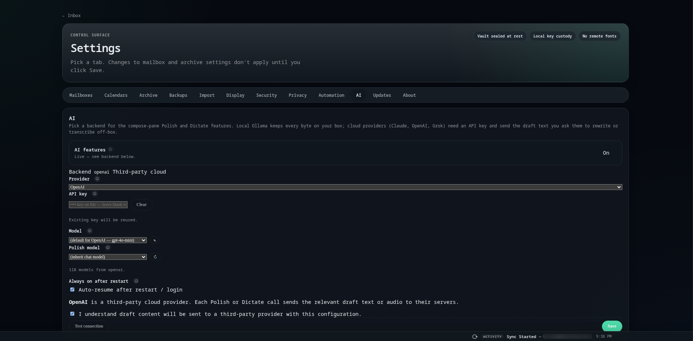
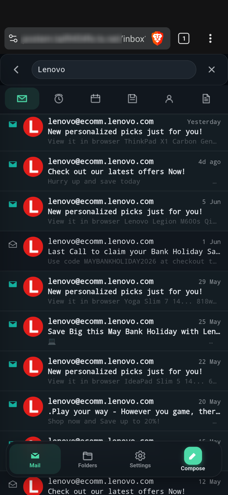

# Postern

## Why Postern

Postern is an email client for people who want Proton-style privacy
without handing their keys to a provider. Your PGP private keys stay
on your own machine, and [Autocrypt](https://autocrypt.org) handles
key discovery between compatible clients quietly in the background.

Postern is a **client**, not a mail server. It keeps using whichever
IMAP and SMTP provider you already have — Gmail, Fastmail, iCloud,
ProtonMail Bridge, or your own host — then adds encrypted local
storage, your own keys, and a web UI you control.

If you choose archive mode, Postern can pull every message off the
provider and keep the only copy in your SQLCipher-encrypted vault.
After that the provider becomes a relay: it carries new mail in and
out while the archive lives on your hardware.

PGP mail to another compatible user is encrypted end to end. Your
provider sees ciphertext and routing headers, not the message body.
Remote access is handled through [Tailscale](https://tailscale.com),
so you do not need public DNS, open inbound ports, or a hosted
account with your mail archive inside it.

## What you get

-   :material-key-variant:{ .lg .middle } __Your keys, never theirs__

    ---

    PGP private keys live on your box. Autocrypt does the handshake
    with the people you email, so encryption "just works" between
    Postern users and any Autocrypt-compatible client.

-   :material-server-network:{ .lg .middle } __Bring any provider__

    ---

    Gmail, Fastmail, iCloud, your own Postfix — anything that speaks
    IMAP and SMTP. Postern doesn't replace your mail flow, it
    replaces the client reading it.

-   :material-shield-lock:{ .lg .middle } __Private by default__

    ---

    SQLCipher-encrypted vault on disk. Remote access over Tailscale's
    WireGuard mesh — no inbound ports, no exposed DNS. Free for
    personal use.

-   :material-currency-usd-off:{ .lg .middle } __No subscription__

    ---

    One-off Pro license or the Apache-2.0 Community build. No
    per-mailbox fees, no recurring billing, no "Plus tier required
    for X." Your hardware, your bill.

## AI, only if you want it

{ loading=lazy }

AI in Postern is **opt-in and off by default**, and we keep it
deliberately simple for privacy. The everyday tools are the modest
ones: **voice dictation** for hands-free writing, a
**"polish this" rewrite** that cleans up just the selected text,
and Harper-powered grammar and spell check. Nothing turns on until
you switch it on.

By default these run on [Ollama](https://ollama.com) on your own
machine — fully local, nothing leaves the box. If you'd rather use
a hosted model for speed or size, Postern also speaks the OpenAI
API and compatible endpoints (Anthropic, OpenRouter, your own
proxy); you bring the key, and the settings make it obvious when a
feature would send text off your server. Power users can enable a
local mailbox assistant (**Datas**) on top, but the simple,
private defaults are the point.

## On any device

Postern is responsive top to bottom. Same inbox, same keys, same
encrypted vault — whether you're on a desktop, laptop, or phone
connected over Tailscale. Sender chips, folder counts, and search
all carry across.

## Two editions

|                                       | **Postern Pro**                                | **Postern Community** |
| ------------------------------------- | ---------------------------------------------- | --------------------- |
| License                               | Paid (one-off, lifetime install, 3 yrs updates) | Apache 2.0            |
| Mailbox cap                           | Unlimited                                      | 3                     |
| Tailscale + remote access             | Yes                                            | No (localhost-only)   |
| Trusted-device sessions               | Yes                                            | No                    |
| AI assist (dictation, polish; opt-in) | Yes                                            | No                    |
| VPN kill-switch (NordVPN / Mullvad)   | Yes                                            | No                    |
| Updates                               | Signed releases, in-app installer               | `git pull && ./install.sh --update` |

[Buy a Pro license](https://billing.postern.email){ .md-button .md-button--primary }
[Community source](https://github.com/dazller4554328/postern-community){ .md-button }

## Start here

[**Install Postern**
Tailscale-native Pro install, usually 10–15 minutes from a clean Ubuntu box.](install/index.md)

[**Home server install**
Run Postern on a NUC, mini-PC, idle workstation, or Pi 5 you already own.](install/home-server.md)

[**Community edition**
Apache-2.0 build for local use when you do not need remote access.](install/community.md)

[**Reference**
Storage invariants, migration paths, and deeper operational notes.](reference/index.md)

